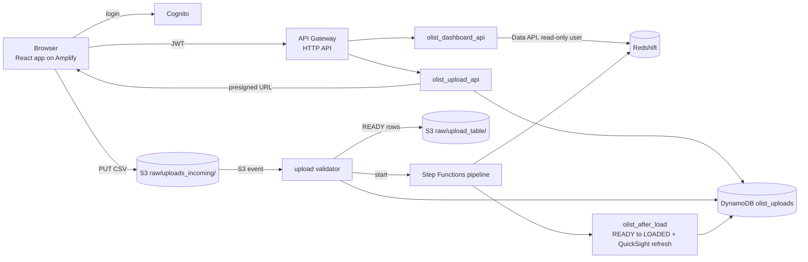

# Olist Analytics: web app

A secure web front end for the Olist AWS data pipeline. Logged-in users see live KPIs and charts
from **Amazon Redshift**, and admins can add or correct data for any Olist table. Every upload is
validated, then loaded through the same pipeline into Redshift and QuickSight automatically.

**Stack:** React 19 + TypeScript + Vite · Recharts · Leaflet · Amazon Cognito (login) ·
API Gateway (HTTP API, JWT authorizer) · AWS Lambda (Python 3.12) · Redshift Data API ·
S3 presigned uploads · DynamoDB · Step Functions · AWS Amplify Hosting

## Features

| Page | What it does |
|---|---|
| **Dashboard** | KPIs (revenue, orders, average delivery days, late %), revenue by month, a map of orders by Brazilian state, top 10 categories, payment types, rows per data source |
| **Upload data** (admin) | Pick one of 9 Olist tables, preview its data, then **enter one row** (generated form) or **upload a CSV** (template download). Shows each upload's status: WAITING_FILE → VALIDATING → READY / REJECTED → LOADED |
| **Process now** (admin) | Starts the pipeline on demand. Valid uploads also start it automatically |

## Architecture



## Backend Lambdas (`backend/`)

| Folder | Lambda | Trigger | Job |
|---|---|---|---|
| `dashboard_api` | `olist_dashboard_api` | `GET /dashboard` | 6 Redshift queries in parallel, cached for 5 minutes |
| `upload_api` | `olist_upload_api` | `POST /uploads`, `GET /uploads`, `GET /preview`, `POST /process` | presigned upload URL, upload list, table preview, start the pipeline |
| `upload_validator` | upload validator | S3 object created | checks columns, types, allowed values, table rules, duplicate keys, and that referenced ids exist; writes JSON Lines for the pipeline |
| `after_load` | `olist_after_load` | last pipeline step | marks uploads LOADED, refreshes QuickSight SPICE, starts a follow-up run for late uploads |
| `ask_data` | `olist_ask_data` | `POST /ask` (in progress) | text-to-SQL with Amazon Bedrock (cross-account role), SELECT-only safety check, read-only Redshift user |

Each file's header lists its environment variables.

## Security

- Every API route requires a **Cognito JWT**; upload and process routes also require the **admin** group.
- The browser never holds AWS keys: files go to S3 with a **5-minute presigned URL** for one exact key.
- Redshift is read with a **read-only database user** whose password lives in **Secrets Manager**.
- Uploaded data is validated **before** it can reach the warehouse; one bad row rejects the whole file.

## Run locally

```bash
npm install
cp .env.example .env   # fill in the Cognito and API values
npm run dev            # http://localhost:5173
```

`npm run build` creates `dist/`. Amplify builds with [`amplify.yml`](amplify.yml).
